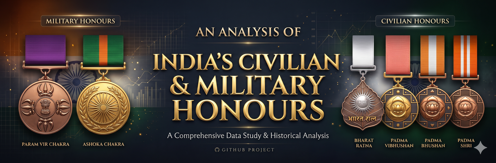

<p align="center">
  
</p>


      

Team 007, Course Project, Data Analysis and Interpretation (DAI)

---

**Table of Contents**


- [Overview](#overview)
- [Research Questions](#research-questions)
- [Datasets](#datasets)
- [Methodology](#methodology)
- [Project Status](#project-status)
- [Directory Structure](#directory-structure)
- [Getting Started](#getting-started)
  - [Prerequisites](#prerequisites)
  - [Installation](#installation)
  - [Manual installation](#manual-installation)
- [Usage](#usage)
- [Tech Stack](#tech-stack)
- [Team](#team)
  - [Contributions](#contributions)
- [Acknowledgements](#acknowledgements)

---

## Overview

This project studies how the Indian state has recognised service and sacrifice since independence. It compares two kinds of recognition: civilian honours (the Bharat Ratna and the Padma awards) and gallantry awards (the Ashoka Chakra and the Param Vir Chakra).

The analysis looks at who receives these honours, where they come from, how old they are, and how the pattern has shifted across decades. Setting the two groups side by side shows how recognition is based on the decades surrounding it and how the conditions and origins of the awardees change with time.

## Research Questions

The work is organised around four questions. Each has a null hypothesis and a set of alternatives that are tested with charts, maps and statistical tests.

1. **Region and age of civilian awardees.** How do the region and age distributions of civilian awardees in the first four decades compare with those in the most recent four decades?
2. **Gallantry versus civilian awardees.** How do gallantry awardees compare with civilian awardees in age, and how common are posthumous awards among them?
3. **Category mix.** Has the mix of civilian award categories shifted across decades, for example towards grassroots social work and away from fields such as civil service and literature?
4. **Representation of women.** Has the representation of women among civilian awardees increased, and is that change spread across fields or concentrated in a few?

## Datasets

All three datasets are public and no access permission is required.

| File | Contents | Source |
| ------ | ---------- | -------- |
| `nationalawards.csv` | Bharat Ratna and Padma award recipients | Kaggle |
| `ashokachakra.csv` | Ashoka Chakra recipients, the highest peacetime gallantry award | Kaggle, Gallantry Awards portal |
| `param_vir_chakra_recipients.csv` | Param Vir Chakra recipients, the highest wartime gallantry award | Gallantry Awards portal, Government of India |

Older records have missing fields and inconsistent spellings of names and states. The analysis is restricted to attributes that are actually recorded in the data.

## Methodology

1. **Cleaning and standardisation.** Raw files are kept unchanged. A reusable cleaning function produces the processed datasets, so the pipeline can be re-run whenever the source data changes.
2. **Feature derivation.** Variables such as decade, state of origin, gender, age at award and posthumous status are derived where the data allow.
3. **Exploration.** Time-series plots, grouped bar charts and statistical heatmaps compare distributions across decades, award domains and states.
4. **Hypothesis testing.** Where the data support it, statistical tests check whether observed differences are larger than chance would produce.

## Project Status

| Stage | State |
| ------- | ------- |
| Dataset collection | Complete |
| Cleaning of gallantry datasets | Complete |
| Cleaning of civilian awards, 1954 to 1960 | Complete |
| Cleaning of civilian awards after 1960 | Complete |
| Exploratory analysis and visualisation | Complete |
| Hypothesis testing | Complete |
| Final report and presentation | Complete |

## Directory Structure

```text
.
├── assets
│   └── banner.png
├── datasets
│   ├── cleaned_datasets
│   │   ├── ashoka_chakra_cleaned.csv
│   │   ├── cleaning.ipynb
│   │   ├── national_awards_cleaned.csv
│   │   └── param_vir_chakra_cleaned.csv
│   ├── processed_datasets
│   │   ├── ashoka_chakra_with_yob.csv
│   │   ├── national_awards_with_yob.csv
│   │   └── param_vir_chakra_with_yob.csv
│   └── raw_datasets
│       ├── ashoka_chakra.csv
│       ├── national_awards.csv
│       └── param_vir_chakra.csv
├── moodleSubmissions
│   ├── checkpointOne.pdf
│   ├── final.pdf
│   └── Project_Proposal.pdf
├── q1
│   ├── age_summary_by_period.csv
│   ├── age_test.csv
│   ├── region_age_distribution.ipynb
│   ├── region_counts_by_period.csv
│   ├── region_percentages_by_period.csv
│   └── region_test.csv
├── q2
│   └── age and posthumous.ipynb
├── q3
│   ├── distribution.ipynb
│   ├── fieldCounts.csv
│   └── fieldPercentages.csv
├── q4
│   ├── awards_with_gender.csv
│   ├── decade_field_women_awardees.csv
│   ├── decade_women_awardees.csv
│   ├── female_contribution.ipynb
│   ├── gender_detect.py
│   ├── gender_overrides.csv
│   ├── national_awards_cleaned.csv
│   └── women_field_composition.csv
├── readme.md
├── report
│   ├── assets
│   │   ├── ageCompare.png
│   │   ├── awardAge.png
│   │   ├── fieldCompare.png
│   │   ├── fieldShare.png
│   │   ├── postHumous.png
│   │   ├── region.png
│   │   └── representation.png
│   ├── report.pdf
│   └── report.typ
├── requirements.txt
└── setup.sh
```


## Getting Started

### Prerequisites

- Python 3.8 or newer
- `pip` and the `venv` module
- Git
- A bash shell (built in on macOS and Linux; use Git Bash or WSL on Windows)

The setup script checks for Python and pip and prints an install hint for your OS if either is missing. It does not install them.

### Installation

Clone the repository:

```bash
git clone https://github.com/vedanshgarg737/DAI_PROJECT_007.git
cd DAI_PROJECT_007
```

Run the setup script:

```bash
chmod +x setup.sh
./setup.sh
```

The script creates a virtual environment in `.venv`, installs everything in `requirements.txt`, and registers a Jupyter kernel named `Python (DAI_PROJECT_007)`.

Activate the environment:

```bash
# macOS / Linux / Git Bash
source .venv/bin/activate

# Windows PowerShell
.venv\Scripts\Activate.ps1
```

### Manual installation

If you prefer not to use the script:

```bash
python3 -m venv .venv
source .venv/bin/activate
python -m pip install --upgrade pip
python -m pip install -r requirements.txt
```

## Usage

Activate the environment and start JupyterLab:

```bash
# macOS / Linux / Git Bash
source .venv/bin/activate

# Windows PowerShell
.venv\Scripts\Activate.ps1

jupyter lab
```

Open the notebooks and select the `Python (DAI_PROJECT_007)` kernel. Run `<cleaning-notebook-name>.ipynb` first, since the analysis notebooks read the processed datasets it produces.

When you are finished, leave the environment with:

```bash
deactivate
```

## Tech Stack

| Purpose | Tools |
| --------- | ------- |
| Data handling | Pandas |
| Statistics | SciPy (`scipy.stats`) |
| Visualisation | Matplotlib, Seaborn |
| Notebooks | Jupyter |
| Version control | Git, GitHub |

## Team

| Name | Roll Number |
| ------ | ------------- |
| Vedansh Garg | 25B0950 |
| Akshita Jain | 25B0999 |
| Maulik | 25B1002 |
| Arush Anand | 25B1012 |

**Mentor:** Mayank Jain

### Contributions

- **Vedansh Garg** created the repository and the project proposal, and manages the repository.
- **Akshita Jain** has explored award trends over time and prepared the checkpoint report.
- **Maulik** added year of birth to the gallantry and early civilian records and filled in missing Ashoka Chakra entries.
- **Arush Anand** added the raw dataset files and wrote the cleaning function for the processed datasets.

Every member contributes to shared work across the project.

## Acknowledgements

- Mayank Jain, for mentoring the project.
- The authors of the public Kaggle notebooks on the Padma awards and the Ashoka Chakra, whose datasets this project builds on.
- The Gallantry Awards portal, Government of India.
